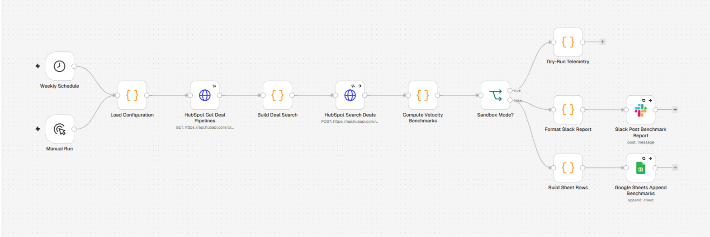
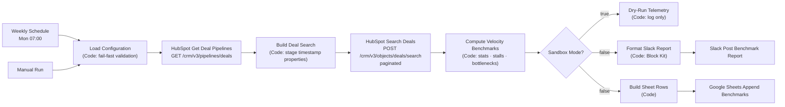

# hubspot-deal-stage-velocity-benchmark-calculator

An n8n workflow package that pulls HubSpot deal stage history every week, benchmarks how long deals spend in each pipeline stage and how long they take to move from stage to stage, and flags the **stalled deals** and **structural bottlenecks** slowing your sales cycle. The report is delivered to Slack and, optionally, appended to Google Sheets to build a benchmark history.

**Read-only by design:** the workflow never writes to HubSpot.


---

## Table of contents

1. [What you get](#what-you-get)
2. [Workflow architecture](#workflow-architecture)
3. [How the benchmarks are calculated](#how-the-benchmarks-are-calculated)
4. [Repository layout](#repository-layout)
5. [Prerequisites](#prerequisites)
6. [Step-by-step import](#step-by-step-import)
7. [Node credential setup](#node-credential-setup)
8. [Configuration reference](#configuration-reference)
9. [Operational guidance](#operational-guidance)
10. [Development and testing](#development-and-testing)
11. [Troubleshooting](#troubleshooting)
12. [Disclaimer](#️-disclaimer--liability-limitation)
13. [License](#license)

---

## What you get

For each deal pipeline:

- **Time in stage**: n, mean, median, p75, p90, min and max days for every open stage.
- **Stage-to-stage durations**: how long deals take to get from entering one stage to entering the next, including skipped stages and moves to closed lost.
- **Advance rate per stage**: deals that moved forward ÷ deals that left the stage (forward or lost).
- **Pipeline health**: deals analysed, open / won / lost, win rate, and median sales cycle (create → closed won).
- **Stalled deals**: open deals sitting in a stage longer than that stage's threshold (by default 2× its historical median), ranked by how far over they are, with HubSpot links.
- **Bottleneck stages**: flagged with explicit reasons, e.g. *slow stage* (median far above the pipeline baseline), *high stall rate*, *low conversion*.

Example Slack report (from the synthetic test data in this repository):

```
📊 Deal Stage Velocity Benchmarks · 2026-06-01
187 deals analysed · last 180 days by `createdate` · 10 stalled · 2 bottleneck stage(s)
---
Sales Pipeline · 147 deals · 25 open · win rate 15% · median cycle 25.4d (n=18)

Stage                           In  Adv%  Median     P90  Open Stall
--------------------------------------------------------------------
  Appointment scheduled        147   82%    3.3d    6.1d     1     0
! Qualified to buy             106   70%      6d   12.1d     5     2
  Presentation scheduled        81   81%    5.2d    9.5d     3     0
! Decision maker bought-in      60   31%   14.6d   40.9d    15     8
  Contract sent                 20   95%    4.8d    7.9d     1     0

🚨 Bottlenecks
• Decision maker bought-in: slow stage (median 14.6d vs pipeline baseline 5d); high stall rate (8 of 15 open deals stalled, 53%)
• Qualified to buy: high stall rate (2 of 5 open deals stalled, 40%)
⌛ Stalled deals (10)
• Deal 50000186: 99d in Decision maker bought-in (threshold 29.2d) · owner 901
• …
```

`!` marks a bottleneck stage. Deals are listed by ID and link; names appear only if you set `INCLUDE_DEAL_NAMES=true`.

---

## Workflow architecture





| # | Node | Type | Role |
| --- | --- | --- | --- |
| 1 | Weekly Schedule | Schedule Trigger | Runs every Monday at 07:00 (instance or workflow timezone). |
| 2 | Manual Run | Manual Trigger | On-demand runs and testing. |
| 3 | Load Configuration | Code | Validates every environment variable and stops the run with a list of problems if anything is wrong. |
| 4 | HubSpot Get Deal Pipelines | HTTP Request | Reads pipelines, stage IDs, order and closed / won metadata. |
| 5 | Build Deal Search | Code | Builds the search body with every stage's `entered` / `exited` timestamp property; ends cleanly if no pipelines match. |
| 6 | HubSpot Search Deals | HTTP Request | Paginated deal search (100 per page, paced at 4 requests per second). Errors continue as items. |
| 7 | Compute Velocity Benchmarks | Code | The analytics engine (see below). Outputs one `benchmark_report` item. |
| 8 | Sandbox Mode? | IF | `SANDBOX_MODE=true` routes to the dry run; otherwise to delivery. |
| 9 | Dry-Run Telemetry | Code | Logs the full report as text; posts nothing. |
| 10 | Format Slack Report | Code | Block Kit message(s), split to respect Slack's 50-block limit. Returns no items if `ENABLE_SLACK=false`. |
| 11 | Slack Post Benchmark Report | Slack | Posts to `SLACK_CHANNEL`. |
| 12 | Build Sheet Rows | Code | One row per pipeline stage. Returns no items if `ENABLE_GOOGLE_SHEETS=false`. |
| 13 | Google Sheets Append Benchmarks | Google Sheets | Appends rows to `GOOGLE_SHEETS_SHEET_NAME`, building a week-over-week history. |

**Single source of truth.** All JavaScript lives in `src/config.js` and `src/velocityEngine.js`. `npm run build` inlines both into the Code nodes of `workflow.json`, so the code that runs in n8n is exactly the code under test. CI fails if `workflow.json` drifts from `src/`. Edit the source files, not the Code nodes.

---

## How the benchmarks are calculated

### Stage history

HubSpot records when a deal enters and leaves each stage in calculated properties named after the stage ID: `hs_v2_date_entered_<stageId>` / `hs_v2_date_exited_<stageId>`, and the older `hs_date_entered_<stageId>` / `hs_date_exited_<stageId>`. The workflow requests both families and uses the first one present (`STAGE_ENTERED_PREFIXES`, `STAGE_EXITED_PREFIXES`).

> These properties are named `hs_date_entered_<stageId>`, not `hs_date_entered_stage_<stageId>`. For the default sales pipeline, the stage IDs are values such as `appointmentscheduled`; custom pipelines use numeric IDs.

For each deal, the stages it entered are sorted by entry time to form a timeline:

| Visit outcome | Rule | Used for |
| --- | --- | --- |
| `ADVANCED` | the next stage entered is not closed lost | completed dwell, advance rate |
| `LOST` | the next stage entered is closed lost | completed dwell, advance rate |
| `OPEN` | it is the deal's current, open stage | stall detection (dwell = now − entered) |
| `WON_TERMINAL` / `LOST_TERMINAL` | closed stages | win rate, sales cycle |

**Dwell time** in a stage = `exited − entered` when a valid exit timestamp exists, otherwise `next stage entered − entered`. Exits recorded before entry are ignored and counted as data-quality issues.

### Metrics

| Metric | Definition |
| --- | --- |
| Time in stage | Completed dwell times in days: n, mean, median, p75, p90, min, max (linear-interpolated percentiles) |
| Stage-to-stage duration | Days from entering stage A to entering the next stage B, for every observed A → B pair |
| Advance rate | `advanced / (advanced + lost)` for the stage |
| Win rate | `won / (won + lost)` among deals in the window |
| Sales cycle | Days from `createdate` to entering the won stage (or `closedate`) for won deals |

A deal is in scope when its `DATE_FILTER_PROPERTY` (default `createdate`) falls within the last `LOOKBACK_DAYS` (default 180). This is a cohort view of recent deals.

### Stalled deals

An open deal is **stalled** when its time in the current stage exceeds the stage threshold:

| Source | Threshold |
| --- | --- |
| `OVERRIDE` | per-stage days from `STAGE_THRESHOLD_OVERRIDES_JSON` |
| `BENCHMARK_<STAT>_X<m>` (default) | `max(STALL_MIN_DAYS, STALL_BENCHMARK_MULTIPLIER × stage STALL_BENCHMARK_STAT)` when the stage has ≥ `MIN_SAMPLE_SIZE` completed visits |
| `FIXED` | `STALL_THRESHOLD_DAYS` for all stages (`STALL_THRESHOLD_MODE=fixed`) |
| `FALLBACK_FIXED` | `STALL_THRESHOLD_DAYS` when there is not enough history for a benchmark |

Stalled deals are ranked by `days in stage ÷ threshold`.

### Bottleneck stages

An open stage is flagged when one or more of these hold:

| Reason | Condition (defaults) |
| --- | --- |
| `SLOW_STAGE` | median dwell ≥ 1.5 × the median of the pipeline's other stage medians (both with ≥ 5 completed visits) |
| `HIGH_STALL_RATE` | at least 3 open deals and ≥ 30 % of them stalled |
| `LOW_CONVERSION` | ≥ 5 resolved visits and advance rate < 25 % |

Stages are ranked by number of reasons, then by median dwell.

---

## Repository layout

```
hubspot-deal-stage-velocity-benchmark-calculator/
├── .github/workflows/ci.yml       # lint, fixture reproducibility, build check, tests, simulation
├── scripts/
│   ├── build-workflow.js          # compiles src/ into workflow.json
│   ├── generate-fixtures.js       # deterministic synthetic HubSpot responses
│   └── simulate.js                # offline run of the Code nodes against fixtures
├── src/
│   ├── config.js                  # env parsing + fail-fast validation
│   └── velocityEngine.js          # timelines, statistics, stalls, bottlenecks, report formats
├── test/
│   ├── fixtures/                  # pipelines.json, deals-page-1.json, deals-page-2.json (synthetic)
│   ├── velocityEngine.test.js
│   └── workflow.test.js
├── workflow.json                  # importable n8n workflow (generated)
├── .env.example                   # configuration template (SANDBOX_MODE=true)
├── .gitignore
├── DISCLAIMER.md
├── LICENSE
├── package.json                   # zero dependencies
└── README.md
```

---

## Prerequisites

- **n8n 1.x** (self-hosted or cloud) with Schedule Trigger 1.2, Code 2, HTTP Request 4.2, IF 2, Slack 2.2 and Google Sheets 4.5 nodes.
- Environment-variable access from Code nodes and expressions: `N8N_BLOCK_ENV_ACCESS_IN_NODE=false`. On n8n Cloud, where custom environment variables may not be available, see [Operational guidance](#operational-guidance).
- A **HubSpot private app** with read access to deals.
- A **Slack app** (bot token) and/or **Google Sheets** OAuth2 credentials for delivery.
- **Node.js ≥ 20** only if you want to run the tests or rebuild `workflow.json` locally.

---

## Step-by-step import

1. **Download** `workflow.json` from this repository (or clone it).
2. **Configure the environment.** Copy `.env.example` to `.env`, set at least `HUBSPOT_PORTAL_ID` and `SLACK_CHANNEL`, keep `SANDBOX_MODE=true`, and load the file into your n8n process (for example `env_file: .env` in docker-compose). Restart n8n.
3. **Import.** In n8n: *Workflows → Add workflow → ⋯ → Import from File…* and select `workflow.json`. The workflow is imported **inactive**.
4. **Attach credentials** to the four nodes listed below (n8n marks them with a warning icon until you do).
5. **Dry run.** Open *Manual Run* and click *Execute workflow*. Open **Dry-Run Telemetry** and read the `lines` output (also printed to the n8n server log). Check stage names, sample sizes and thresholds.
6. **Tune.** Adjust `PIPELINE_IDS`, `LOOKBACK_DAYS`, stall and bottleneck settings until the results match what your sales team recognises. Restart n8n after changing environment variables.
7. **Go live.** Set `SANDBOX_MODE=false`, restart, run once manually and confirm the Slack post (and sheet rows, if enabled).
8. **Activate** the workflow so the weekly schedule runs, and set an **Error Workflow** in *Workflow settings*.

---

## Node credential setup

All credentials are referenced by placeholder IDs (`REPLACE_WITH_…`) in `workflow.json`; none are stored in the repository.

| Node(s) | n8n credential type | How to create it |
| --- | --- | --- |
| HubSpot Get Deal Pipelines, HubSpot Search Deals | **HubSpot App Token** | HubSpot → *Settings → Integrations → Private Apps → Create*. Scope: `crm.objects.deals.read`. Paste the token (`{{HUBSPOT_PRIVATE_APP_TOKEN}}`) into a new n8n *HubSpot App Token* credential. |
| Slack Post Benchmark Report | **Slack API** | Create a Slack app with the `chat:write` bot scope, install it, paste the bot token (`{{SLACK_BOT_TOKEN}}`), and invite the bot to `SLACK_CHANNEL`. |
| Google Sheets Append Benchmarks | **Google Sheets OAuth2 API** | Follow n8n's Google OAuth2 credential guide (`{{GOOGLE_OAUTH_CLIENT_ID}}` / `{{GOOGLE_OAUTH_CLIENT_SECRET}}`). Create a sheet tab named `stage_benchmarks` (or set `GOOGLE_SHEETS_SHEET_NAME`) with a header row matching the columns below. |

**Google Sheets columns** (add them as the header row; the node maps fields by name):

```
run_date, window_start, pipeline_id, pipeline_label, stage_id, stage_label, stage_order, entered, advanced, lost, open, stalled,
conversion_rate, dwell_n, dwell_mean_days, dwell_median_days, dwell_p75_days, dwell_p90_days, stall_threshold_days,
threshold_source, bottleneck, bottleneck_reasons, pipeline_win_rate, pipeline_median_cycle_days
```

To deliver to Airtable or a database instead, replace the Google Sheets node with the corresponding n8n node; *Build Sheet Rows* already emits flat rows.

---

## Configuration reference

| Variable | Default | Description |
| --- | --- | --- |
| `SANDBOX_MODE` | `true` | `true` = log only; `false` = post to Slack / Sheets. HubSpot is never written to. |
| `AS_OF_DATE` | *(now)* | Fixed "now" (ISO date) for reproducible reports and backtests. |
| `HUBSPOT_PORTAL_ID` | *(blank)* | Numeric portal ID for deal links; `your-portal-id` counts as unset. |
| `HUBSPOT_APP_BASE_URL` | `https://app.hubspot.com` | Base for deal links (EU portals may differ). |
| `PIPELINE_IDS` | *(all)* | Comma-separated pipeline IDs to analyse. |
| `LOOKBACK_DAYS` | `180` | Window size (7–1825). |
| `DATE_FILTER_PROPERTY` | `createdate` | `createdate`, `hs_lastmodifieddate` or `closedate`. |
| `SEARCH_PAGE_SIZE` | `100` | Deals per search page (1–200). |
| `STAGE_ENTERED_PREFIXES` | `hs_v2_date_entered_,hs_date_entered_` | Entry timestamp property prefixes, in priority order. |
| `STAGE_EXITED_PREFIXES` | `hs_v2_date_exited_,hs_date_exited_` | Exit timestamp property prefixes. |
| `STALL_THRESHOLD_MODE` | `benchmark` | `benchmark` or `fixed`. |
| `STALL_BENCHMARK_STAT` | `median` | `median`, `p75`, `p90` or `mean`. |
| `STALL_BENCHMARK_MULTIPLIER` | `2` | Multiplier applied to the benchmark stat. |
| `STALL_THRESHOLD_DAYS` | `21` | Fixed threshold, and fallback for thin stages. |
| `STALL_MIN_DAYS` | `7` | Floor for benchmark thresholds. |
| `STAGE_THRESHOLD_OVERRIDES_JSON` | *(blank)* | e.g. `{"contractsent": 14}`. |
| `MIN_SAMPLE_SIZE` | `5` | Minimum completed visits for benchmark-based checks. |
| `BOTTLENECK_DWELL_MULTIPLIER` | `1.5` | `SLOW_STAGE` sensitivity. |
| `BOTTLENECK_STALL_RATE` | `0.3` | `HIGH_STALL_RATE` sensitivity. |
| `BOTTLENECK_MIN_CONVERSION` | `0.25` | `LOW_CONVERSION` sensitivity. |
| `INCLUDE_DEAL_NAMES` | `false` | Include deal names in the report. |
| `MAX_STALLED_IN_REPORT` | `15` | Stalled deals listed per pipeline in Slack. |
| `ENABLE_SLACK` / `SLACK_CHANNEL` | `true` / `#revops-reports` | Slack delivery. |
| `ENABLE_GOOGLE_SHEETS` | `false` | Google Sheets delivery. |
| `GOOGLE_SHEETS_DOCUMENT_ID` | `{{GOOGLE_SHEETS_DOCUMENT_ID}}` | Sheet ID from its URL. |
| `GOOGLE_SHEETS_SHEET_NAME` | `stage_benchmarks` | Tab name. |

Validation is fail-fast: invalid numbers, unknown modes, malformed JSON, bad prefixes or pipeline IDs, and (in live mode) a missing delivery target stop the run before HubSpot is called, with every problem listed together.

---

## Operational guidance

**Cadence.** Weekly is the right rhythm for stage benchmarks: daily runs mostly re-report the same stalls. Change the day or time on *Weekly Schedule*; set the workflow timezone in *Workflow settings*.

**Choosing the window.**
- `createdate` + 180 days (default): a cohort of recently created deals; stable and comparable week to week.
- `hs_lastmodifieddate` + 90 days: emphasises currently active deals.
- Long sales cycles (enterprise): increase `LOOKBACK_DAYS` to 365 so slow stages have enough completed visits.

**Large portals.** HubSpot search returns at most 10,000 results per query and the workflow fetches up to 100 pages. If a run approaches that, narrow the scope with `PIPELINE_IDS` or a shorter window, or duplicate the workflow per pipeline.

**Rate limits.** Search requests are paced at 4 per second and every HubSpot call retries 3 times. A typical weekly run makes 1 pipelines call plus 1 search call per 100 deals.

**Reading the report.**
- Treat bottleneck flags as prompts for a pipeline review, not verdicts. Check the n behind each median.
- A stage with a long median and a low advance rate is usually a qualification or exit-criteria problem. A long median with a normal advance rate usually points to process or resourcing.
- Use the Google Sheets history to track whether changes to stages or playbooks actually move the medians.

**Privacy.** Keep `INCLUDE_DEAL_NAMES=false` for broad channels. Owner IDs and deal IDs are shown so managers can follow up in HubSpot, where access controls apply.

**n8n Cloud.** If custom environment variables are not available, the Code nodes fall back to safe defaults (sandbox on). To configure the workflow without `.env`, edit the defaults in `src/config.js`, run `npm run build`, and re-import. Better still, self-host or use a plan that supports variables.

**Monitoring.** Configure an Error Workflow. The report's `status` is `OK`, `PARTIAL_FETCH_ERROR`, `PARTIAL_RATE_LIMITED`, `FETCH_ERROR` or `ENGINE_ERROR`; partial runs are labelled in Slack.

**Updating logic.** Edit `src/`, then run `npm test` and `npm run build`, re-import `workflow.json`, and re-select credentials if prompted.

---

## Development and testing

No dependencies to install: Node.js ≥ 20 is enough.

| Command | Purpose |
| --- | --- |
| `npm test` | Unit tests and workflow tests (`node:test`). |
| `npm run simulate` | Runs the compiled Code nodes offline against the synthetic fixtures (sandbox output). |
| `npm run simulate:live` | Shows the Slack message and sheet rows a live run would produce. |
| `npm run build` | Regenerates `workflow.json` from `src/`. |
| `npm run build:check` | Fails if `workflow.json` is stale. |
| `npm run fixtures` | Regenerates the deterministic synthetic HubSpot responses. |
| `npm run ci` | Lint, build check and tests. |

The fixtures contain 190 synthetic deals across two pipelines, with a deliberately slow, low-converting stage, planted stalled deals and dirty records (no history, duplicate, unknown pipeline, exit before entry). The tests assert that the engine finds each of them. They also execute every Code node from `workflow.json` in a VM that mimics the n8n runtime, including blocked environment access, empty pipelines, HubSpot API errors and rate limits, and they scan the repository for secrets.

---

## Troubleshooting

| Symptom | Likely cause |
| --- | --- |
| Always ends in *Dry-Run Telemetry* | `SANDBOX_MODE` is still `true`, or environment access is blocked. |
| `Invalid velocity benchmark configuration` | Read the listed problems; each names its variable. |
| `Could not load HubSpot deal pipelines` | Missing credential or missing `crm.objects.deals.read` scope. |
| `Nothing to analyse` in the log | `PIPELINE_IDS` matches no active pipeline. |
| Many `NO_STAGE_HISTORY` skips | Deals were imported without stage history, or your portal uses different property prefixes: check a deal's properties and adjust `STAGE_ENTERED_PREFIXES`. |
| Medians are `–` | Fewer completed visits than needed; widen the window. |
| No Slack post | Bot not invited to the channel, `ENABLE_SLACK=false`, or a channel-name format mismatch (try without `#`). |
| Sheets columns empty | The header row does not match the column names above. |

---

## ⚠️ Disclaimer & Liability Limitation

Use at your own risk. The code, workflows, and scripts provided in this repository (`hubspot-deal-stage-velocity-benchmark-calculator`) are for educational and architectural demonstration purposes.

* **No Liability:** The author and dhRobin Systems assume no responsibility or liability for any direct, indirect, incidental, or consequential damages resulting from the use, misuse, or deployment of these scripts.
* **No Warranty:** All software, n8n JSON blueprints, and JavaScript modules are provided "AS IS" without warranty of any kind, express or implied, including but not limited to merchantability, fitness for a particular purpose, or non-infringement.
* **Production Testing Required:** Always test thoroughly in an isolated staging environment (for example a HubSpot developer test account or sandbox) with `SANDBOX_MODE=true` enabled before connecting live HubSpot credentials.
* **Third-Party APIs & Compliance:** Users are solely responsible for complying with the terms of service, rate limits, data privacy regulations (GDPR/CCPA), and security policies of HubSpot, Slack, Google and any connected services, including reviewing every report before it is shared and controlling who can access the deal data it contains.

The full disclaimer is also available in [DISCLAIMER.md](https://github.com/dhrobinsystems/hubspot-deal-stage-velocity-benchmark-calculator/blob/main/DISCLAIMER.md).

## License

Released under the MIT License. Copyright (c) 2026 DH Robin (dhRobin Systems). See [LICENSE](https://github.com/dhrobinsystems/hubspot-deal-stage-velocity-benchmark-calculator/blob/main/LICENSE).
